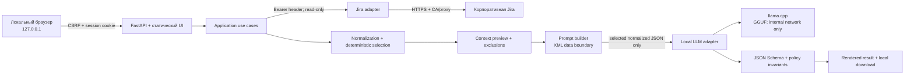

# Архитектура, допущения и ADR

## Допущения и границы MVP

- Репозиторий был пуст; заявленные Postman collection и ручной обезличенный пример не были приложены. Контракты реализованы по Jira API v2 из ТЗ, а тесты используют собственный вымышленный fixture `DEMO-*` за 2024–2026 годы.
- Основная целевая ОС — Windows 11 + WSL2 + Docker Desktop. CPU fallback обязателен. CUDA passthrough поддерживается только после отдельной проверки на Linux/WSL2 с NVIDIA Container Toolkit; для Docker Desktop на macOS GPU не обещается.
- MVP работает с одним куратором в одной локальной браузерной сессии. Массовая обработка и серверный multi-user режим вне scope.
- Jira Server/Data Center может иметь локальные названия и custom fields. Неизвестные поля становятся `null`, а не угадываются.
- Confluence, транскрибация, запись в Jira, team index и coaching стиля куратора намеренно не реализованы.

## Компоненты и поток

Поток данных:

1. PAT приходит из формы или secret-file и живёт только в RAM процесса; в URL, prompt и логи не входит.
2. Jira adapter читает `/myself`, `/field`, `/search`, `/issue/{key}` и `/comment`, учитывая пагинацию и частичную недоступность.
3. Нормализатор очищает представление, извлекает meeting type, дедуплицирует, сортирует и вычисляет только сопоставимые MM delta.
4. Отбор берёт последние три завершённых MM с датой и до десяти последних содержательных interaction; усечение видно пользователю.
5. UI показывает весь выбранный контекст и разрешает исключить источники. Имя не передаётся модели без отдельного checkbox.
6. Jira-текст остаётся user data внутри `<employee_context>`. System prompt не содержит Jira-текста.
7. `llama.cpp` получает строгую JSON Schema. После ответа код проверяет длительность, ссылки, лимиты и запрещённые кадровые/диагностические формулировки. Допустима одна repair-попытка.
8. Результат остаётся в памяти браузера/приложения; Markdown/JSON появляется на диске только по явному скачиванию.

## Модули и зависимости

- `domain.py` — строгие Pydantic domain-модели без инфраструктурных зависимостей;
- `jira.py` — read-only adapter и transport policy;
- `normalization.py` — чистые функции преобразования/отбора;
- `prompting.py`, `llm.py`, `validation.py` — изолированный inference-контур;
- `service.py` — use cases, сессионное состояние, concurrency/cancellation;
- `main.py`, `static/` — HTTP boundary и менеджерский UI;
- `mock_jira/` — отдельный тестовый адаптер, не production dependency.

## Внутренняя схема

Контекст имеет `schema_version=1.0` и типизирован моделями `NormalizedContext`, `Employee`, `MoodMonitoring`, `Interaction`, `Feedback`. Расширения (`incomplete_mood_monitoring`, `mood_dynamics`, `truncated`) добавлены без изменения исходных полей 1.0. `employee_ref` — HMAC-SHA256 от Jira key с локальным keyed secret; ключ HMAC никогда не входит в контекст.

## ADR

### ADR-001 — FastAPI + Pydantic + vanilla web UI

Выбраны Python 3.12, FastAPI, httpx и Pydantic: небольшой deployable, строгие contracts и зрелая async-сеть. UI не имеет Node/CDN/runtime web dependencies. Альтернатива Electron дала бы больший installer и отдельный security surface.

### ADR-002 — отдельный `llama.cpp` process

Inference заменяем через `LocalLLM` protocol. `llama.cpp` даёт GGUF, CPU fallback, аппаратные backends, health endpoint и OpenAI-compatible API с JSON Schema. Model container не публикует порт на host.

### ADR-003 — отсутствие БД

Персональные данные хранятся только в session RAM. В volume сохраняется исключительно field mapping. Это ограничивает историю результатов, но прямо уменьшает privacy/retention risk.

### ADR-004 — session memory token по умолчанию

Браузер передаёт PAT один раз; backend держит его в памяти до завершения сессии/перезапуска. Опциональный `secrets/jira_token` — read-only secret-file для Docker. `.env` токены запрещены.

### ADR-005 — deterministic context before LLM

Арифметика, дедупликация, датировка и отбор выполняются кодом. LLM получает уже ограниченный контекст и не может скрыто выбирать всю историю или вычислять среднее с `null=0`.

## Основные риски проекта

- названия workflow status и feedback issue type отличаются: вынести их в следующий конфиг mapping;
- native JSON Schema совместимость зависит от закреплённого `llama.cpp`; container smoke не заменяет model smoke;
- regex policy — последняя страховка, не полноценный semantic safety classifier; human review остаётся обязательным;
- большие комментарии обрезаются; факт виден через предупреждение только на уровне общего context cut, не по каждому полю;
- корпоративная SSO Jira может не принимать PAT/Bearer без дополнительной схемы auth; она вне текущего MVP.

