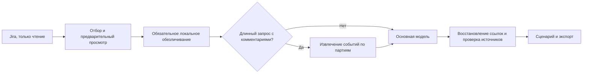

# Архитектура, допущения и ADR

## Допущения и границы MVP

- Основная целевая ОС — Windows 11 + WSL2 + Docker Desktop. CPU fallback обязателен. CUDA passthrough поддерживается только после отдельной проверки на Linux/WSL2 с NVIDIA Container Toolkit; для Docker Desktop на macOS GPU не обещается.
- MVP работает с одним куратором в одной локальной браузерной сессии. Массовая обработка и серверный multi-user режим вне scope.
- Jira Server/Data Center может иметь локальные названия и custom fields. Неизвестные поля становятся `null`, а не угадываются.
- Confluence, транскрибация, запись в Jira, team index и coaching стиля куратора намеренно не реализованы.

## Как данные проходят через приложение

1. Браузер отправляет PAT из формы. Если поле пустое, сервер читает токен из файла секрета. Jira получает токен в заголовке `Authorization`.
2. Jira-клиент читает профиль, задачи и комментарии. Нормализатор приводит пользовательские поля к типам приложения, сортирует записи и рассчитывает динамику Mood Monitoring (MM) по сопоставимым значениям.
3. В предварительный просмотр попадают три последних завершённых MM с датой, отдельно незавершённые MM, до 50 комментариев и до 10 записей обратной связи. Текстовый лимит отбора сокращает список обратной связи. Пользователь может исключить источники перед генерацией.
4. Перед вызовом основной модели локальная Ollama-модель обнаруживает персональные данные. Код также применяет словарь, регулярные выражения и псевдонимы ссылок. Техническая ошибка на этом этапе останавливает генерацию.
5. Основная модель сначала извлекает события из партий комментариев, если суммарная длина сообщений и схемы превышает порог. Для локальной модели порог по умолчанию составляет 18 000 символов, для внешней — 36 000. При сбое извлечения модель получает очищенный текст соответствующих комментариев. Основной запрос содержит JSON внутри `<employee_context>` в пользовательском сообщении.
6. JSON Schema задаёт формат для модели. Сервер восстанавливает ссылки и даты, рассчитывает время этапов, заполняет сведения о качестве данных и проверяет наличие источников у фактов и принадлежность ссылок выбранному контексту. `CURATOR_LLM_REPAIR_ENABLED=true` разрешает одну попытку исправления.
7. `POST /api/generate` возвращает `202` и идентификатор фоновой задачи. Браузер опрашивает `/api/generate/{id}/status` и забирает результат через `/api/generate/{id}/result`. Идентификатор последней задачи хранится в `sessionStorage` для восстановления после обновления вкладки.

## Где искать код

- `main.py` подключает FastAPI, обрабатывает HTTP-запросы и запускает фоновые задачи.
- `session.py` хранит контекст, задачи генерации и их результаты в памяти сессии.
- `service.py` связывает Jira, предварительный просмотр, обработку контекста и генерацию.
- `jira.py` читает данные из Jira. `normalization.py` преобразует и отбирает записи. `domain.py` описывает структуру данных и сопоставление полей.
- `privacy_filter.py` обезличивает контекст. `llm.py` содержит общие запросы к моделям и локальные адаптеры. `external_llm.py` подключает внешний API.
- `prompting.py` и `comment_analysis.py` готовят сообщения моделям. `validation.py` проверяет ссылки и дополняет итог вычисляемыми полями.
- `static/app.js` связывает форму, API и фоновые задачи. `static/result.js` строит редактируемый текст и показывает источники. `export.py` формирует Markdown для серверного API.
- `mock_jira/` реализует демо Jira на вымышленных данных.

## Внутренняя схема

Контекст имеет `schema_version=1.0` и типизирован моделями `NormalizedContext`, `Employee`, `MoodMonitoring`, `Interaction`, `Feedback`. Расширения (`incomplete_mood_monitoring`, `mood_dynamics`, `truncated`) добавлены без изменения исходных полей 1.0. `employee_ref` — HMAC-SHA256 от Jira key с локальным keyed secret; ключ HMAC никогда не входит в контекст.

## ADR

### ADR-001 — FastAPI + Pydantic + vanilla web UI

Выбраны Python 3.12, FastAPI, httpx и Pydantic: небольшой deployable, строгие contracts и зрелая async-сеть. UI не имеет Node/CDN/runtime web dependencies. Альтернатива Electron дала бы больший installer и отдельный security surface.

### ADR-002 — взаимозаменяемые локальные runtime

Inference заменяем через `MainLLM` protocol. `llama.cpp` даёт воспроизводимый Docker CPU fallback, а native Ollama на Apple Silicon использует Metal. Оба адаптера генерируют через локальный OpenAI-compatible API с JSON Schema; health endpoint различается. Единственный адаптер выбирается ключом `CURATOR_LLM_RUNTIME`, а конкретная модель Ollama — ключом `CURATOR_OLLAMA_MODEL` при старте процесса. Gemma 4 поддерживает thinking, системную роль и структурированный JSON; клиент передаёт ей `reasoning_effort=none` по умолчанию, чтобы reasoning не исчерпывал лимит до появления JSON. Только моделям семейства Gemma 3 этот параметр автоматически не отправляется. Start-скрипты останавливают невыбранный runtime и выгружают его модели. Model container не публикует порт на host, Ollama остаётся отдельным host-процессом.

### ADR-003 — отсутствие БД

Персональные данные хранятся только в session RAM. Результаты и Jira-контекст автоматически не сохраняются. Это ограничивает историю результатов, но прямо уменьшает privacy/retention risk.

### ADR-004 — session memory token по умолчанию

Браузер передаёт PAT один раз; backend держит его в памяти до завершения сессии/перезапуска. Опциональный `secrets/jira_token` — read-only secret-file для Docker. `.env` токены запрещены.

### ADR-005 — deterministic context before LLM

Арифметика, дедупликация, датировка и отбор выполняются кодом. LLM получает уже ограниченный контекст и не может скрыто выбирать всю историю или вычислять среднее с `null=0`.

### ADR-006 — внешний runtime только через локальный privacy gateway

Сервис подключает внешний клиент вместе с обязательным `PersonalDataFilter`: локальная специализированная модель, псевдонимы source refs, словарь и regex выполняются до comment extraction и финальной генерации. API-key читается из secret-файла. Ошибка любого обязательного фильтра останавливает операцию до сетевого обращения к внешней LLM. Автоматический фильтр снижает риск, но не заменяет согласование внешней обработки данных.

### ADR-007 — фоновая генерация и polling

Долгий LLM-вызов не удерживает браузерный HTTP-запрос. Start endpoint возвращает `202` и случайный server-side UUID, после чего задача продолжает работу в event loop FastAPI. Status/result доступны только в той же cookie-сессии; завершение сессии отменяет активные задачи и удаляет результаты. UI выполняет короткий polling раз в три секунды, поэтому сетевые лимиты браузера не теряют готовый результат.

## Основные риски проекта

- изменение custom field ID требует нового выпуска приложения; текущие ID должны синхронно обновляться в `FieldMapping` и mock fixture;
- native JSON Schema совместимость зависит от закреплённого `llama.cpp`; container smoke не заменяет model smoke;
- backend не проверяет формулировки и кадровые/диагностические рекомендации; human review обязателен;
- большие комментарии обрезаются; факт виден через предупреждение только на уровне общего context cut, не по каждому полю;
- корпоративная SSO Jira может не принимать PAT/Bearer без дополнительной схемы auth; она вне текущего MVP.
