# Архитектура, допущения и ADR

## Допущения и границы MVP

- Репозиторий был пуст; заявленные Postman collection и ручной обезличенный пример не были приложены. Контракты реализованы по Jira API v2 из ТЗ, а тесты используют собственный вымышленный fixture `DEMO-*` за 2024–2026 годы.
- Основная целевая ОС — Windows 11 + WSL2 + Docker Desktop. CPU fallback обязателен. CUDA passthrough поддерживается только после отдельной проверки на Linux/WSL2 с NVIDIA Container Toolkit; для Docker Desktop на macOS GPU не обещается.
- MVP работает с одним куратором в одной локальной браузерной сессии. Массовая обработка и серверный multi-user режим вне scope.
- Jira Server/Data Center может иметь локальные названия и custom fields. Неизвестные поля становятся `null`, а не угадываются.
- Confluence, транскрибация, запись в Jira, team index и coaching стиля куратора намеренно не реализованы.

## Компоненты и поток

```mermaid
flowchart LR
  U["Локальный браузер\n127.0.0.1"] -->|"Start job + short status polling"| UI["FastAPI + статический UI"]
  UI --> UC["Application use cases"]
  UC -->|"Bearer header; read-only"| J["Jira adapter"]
  J -->|"HTTPS + CA/proxy"| JR["Корпоративная Jira"]
  UC --> N["Normalization + deterministic selection"]
  N --> P["Context preview + exclusions"]
  P --> X{"Runtime external?"}
  X -->|"no"| E["Comment batches\nevent extraction"]
  X -->|"yes"| F["Local PII model\nsource aliases + dictionary + regex"]
  F --> E
  E --> PB["Synthesis prompt\nXML data boundary"]
  C["CURATOR_LLM_RUNTIME\nat process start"] --> L["Single selected LLM adapter"]
  PB -->|"selected normalized JSON only"| L
  L -->|"llama_cpp only"| M["llama.cpp\nDocker + GGUF"]
  L -->|"ollama only"| O["Ollama native\nGemma 4 12B или Qwen3 8B"]
  L -->|"external only; sanitized context"| A["OpenAI-compatible\nHTTPS API"]
  M --> V["Source-reference integrity"]
  O --> V
  A --> V
  V --> R["Rendered result + local download"]
```

Поток данных:

1. PAT приходит из формы или secret-file и живёт только в RAM процесса; в URL, prompt и логи не входит.
2. Jira adapter читает `/myself`, `/search`, `/issue/{key}` и `/comment`, учитывая пагинацию и частичную недоступность. Подтверждённый mapping custom fields зафиксирован в коде и применяется ко всем сессиям.
3. Нормализатор очищает представление, извлекает meeting type, дедуплицирует, сортирует и вычисляет только сопоставимые MM delta.
4. Отбор берёт последние три завершённых MM с датой и до 50 последних комментариев Jira; усечение по общему text budget видно пользователю.
5. UI показывает весь выбранный контекст и разрешает исключить источники. В локальном режиме имя не передаётся модели без отдельного checkbox; во внешнем режиме имя всегда удаляется.
6. Jira-текст остаётся user data внутри `<employee_context>`. System prompt не содержит Jira-текста.
7. В runtime `external` отдельная локальная Ollama-модель сначала обнаруживает персональные данные; затем код применяет словарь, regex и псевдонимы ссылок. При любом техническом сбое этого этапа внешний вызов запрещён.
8. Выбранная модель сначала извлекает события из небольших партий комментариев, сохраняя каждый `source_ref`; затем второй вызов синтезирует общую динамику по сокращённым событиям, MM и mapped-полям. JSON Schema передаётся модели как формат генерации. После ответа код локально восстанавливает псевдонимы источников и проверяет только наличие источника у фактов и принадлежность `source_ref` переданному контексту. Backend не отклоняет ответ по схеме, размерам, расписанию, датам или формулировкам. Допустима одна repair-попытка при оставшихся ошибках целостности.
9. `POST /api/generate` немедленно создаёт фоновую задачу и возвращает серверный `generation_id`. UI опрашивает короткий status endpoint, а после `succeeded` отдельно забирает результат. Идентификатор активной задачи хранится в `sessionStorage`, поэтому обновление вкладки не прерывает ожидание. Результат остаётся только в RAM сессии и браузера; Markdown/JSON появляется на диске только по явному скачиванию.

## Модули и зависимости

- `domain.py` — строгие Pydantic domain-модели без инфраструктурных зависимостей;
- `jira.py` — read-only adapter и transport policy;
- `normalization.py` — чистые функции преобразования/отбора;
- `comment_analysis.py`, `prompting.py`, `llm.py`, `validation.py` — основной локальный двухэтапный inference-контур;
- `external_llm.py`, `privacy_filter.py` — изолированная интеграция внешнего API и предварительное локальное обезличивание;
- `service.py` — use cases, сессионное состояние, concurrency/cancellation;
- `main.py`, `static/` — HTTP boundary и менеджерский UI;
- `mock_jira/` — отдельный тестовый адаптер, не production dependency.

## Внутренняя схема

Контекст имеет `schema_version=1.0` и типизирован моделями `NormalizedContext`, `Employee`, `MoodMonitoring`, `Interaction`, `Feedback`. Расширения (`incomplete_mood_monitoring`, `mood_dynamics`, `truncated`) добавлены без изменения исходных полей 1.0. `employee_ref` — HMAC-SHA256 от Jira key с локальным keyed secret; ключ HMAC никогда не входит в контекст.

## ADR

### ADR-001 — FastAPI + Pydantic + vanilla web UI

Выбраны Python 3.12, FastAPI, httpx и Pydantic: небольшой deployable, строгие contracts и зрелая async-сеть. UI не имеет Node/CDN/runtime web dependencies. Альтернатива Electron дала бы больший installer и отдельный security surface.

### ADR-002 — взаимозаменяемые локальные runtime

Inference заменяем через `LocalLLM` protocol. `llama.cpp` даёт воспроизводимый Docker CPU fallback, а native Ollama на Apple Silicon использует Metal. Оба адаптера генерируют через локальный OpenAI-compatible API с JSON Schema; health endpoint различается. Единственный адаптер выбирается ключом `CURATOR_LLM_RUNTIME`, а конкретная модель Ollama — ключом `CURATOR_OLLAMA_MODEL` при старте процесса. Gemma 4 поддерживает thinking, системную роль и структурированный JSON; клиент передаёт ей `reasoning_effort=none` по умолчанию, чтобы reasoning не исчерпывал лимит до появления JSON. Только моделям семейства Gemma 3 этот параметр автоматически не отправляется. Start-скрипты останавливают невыбранный runtime и выгружают его модели. Model container не публикует порт на host, Ollama остаётся отдельным host-процессом.

### ADR-003 — отсутствие БД

Персональные данные хранятся только в session RAM. Результаты и Jira-контекст автоматически не сохраняются. Это ограничивает историю результатов, но прямо уменьшает privacy/retention risk.

### ADR-004 — session memory token по умолчанию

Браузер передаёт PAT один раз; backend держит его в памяти до завершения сессии/перезапуска. Опциональный `secrets/jira_token` — read-only secret-file для Docker. `.env` токены запрещены.

### ADR-005 — deterministic context before LLM

Арифметика, дедупликация, датировка и отбор выполняются кодом. LLM получает уже ограниченный контекст и не может скрыто выбирать всю историю или вычислять среднее с `null=0`.

### ADR-006 — внешний runtime только через локальный privacy gateway

Внешний клиент не встраивается в основной `llm.py`. Его можно создать только вместе с обязательным `PersonalDataFilter`: локальная специализированная модель, псевдонимы source refs, словарь и regex выполняются до comment extraction и финальной генерации. API-key читается из secret-файла. Ошибка любого обязательного фильтра останавливает операцию до сетевого обращения к внешней LLM. Автоматический фильтр снижает риск, но не заменяет согласование внешней обработки данных.

### ADR-007 — фоновая генерация и polling

Долгий LLM-вызов не удерживает браузерный HTTP-запрос. Start endpoint возвращает `202` и случайный server-side UUID, после чего задача продолжает работу в event loop FastAPI. Status/result доступны только в той же cookie-сессии; завершение сессии отменяет активные задачи и удаляет результаты. UI выполняет короткий polling раз в три секунды, поэтому сетевые лимиты браузера не теряют готовый результат.

## Основные риски проекта

- изменение custom field ID требует нового выпуска приложения; текущие ID должны синхронно обновляться в `FieldMapping` и mock fixture;
- native JSON Schema совместимость зависит от закреплённого `llama.cpp`; container smoke не заменяет model smoke;
- backend не проверяет формулировки и кадровые/диагностические рекомендации; human review обязателен;
- большие комментарии обрезаются; факт виден через предупреждение только на уровне общего context cut, не по каждому полю;
- корпоративная SSO Jira может не принимать PAT/Bearer без дополнительной схемы auth; она вне текущего MVP.
